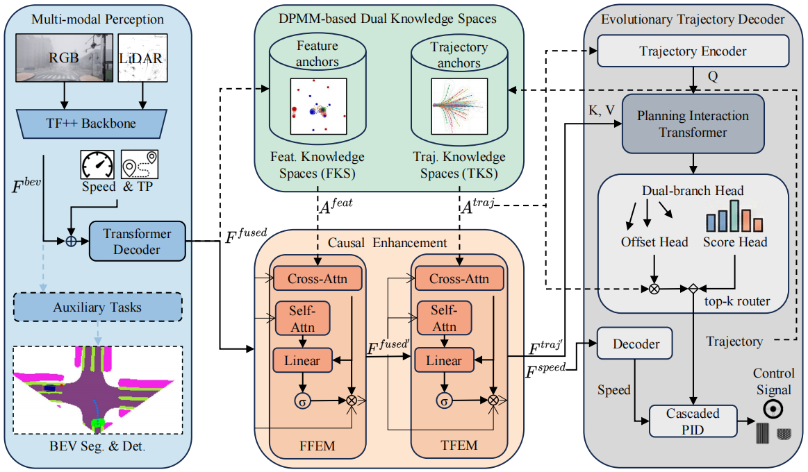

<h1 align="center">
  <span style="color:#2d7ee7;">DeLL</span>: <span style="color:#2d7ee7;">De</span>confounded 
  <span style="color:#2d7ee7;">L</span>ifelong 
  <span style="color:#2d7ee7;">L</span>earning for Autonomous Driving via Dynamic Knowledge Spaces
</h1>

<p align="center">
  
</p>

<p align="center">
  <a href="https://arxiv.org/abs/2603.14354">Paper</a>
</p>

## Overview

**DeLL** is a continual learning framework for end-to-end autonomous driving, built on top of the [CARLA Garage](https://github.com/autonomousvision/carla_garage) (TransFuser++) codebase. It addresses catastrophic forgetting in multi-ability driving scenarios by co-training the neural network with two **Dirichlet Process Mixture Model (DPMM)** knowledge spaces — one for trajectory anchors and one for fused-feature anchors — that are updated *online* during training.

### Key Ideas

1. **Anchor-based trajectory decoding.** Instead of predicting a single trajectory, the model predicts *K* candidate trajectories using DPMM cluster means as transformer-decoder queries. A KL-divergence loss (soft labels from distance-to-GT) plus a weighted regression loss supervise all anchors, while a best-trajectory loss ensures at least one accurate prediction.

2. **Front-door encoders.** Two optional encoder modules (`TrajFrontDoorEncoder`, `FuseFeatFrontDoorEncoder`) enhance the model's intermediate features by cross-attending to DPMM anchors, using a gated fusion to blend augmented and original features.

3. **Online alternating training.** Two ring buffers collect ground-truth routes and model features every batch. When a buffer fills, the corresponding DPMM is fitted on rank 0, new anchors are broadcast to all ranks, and the model's decoder/encoder anchor buffers are hot-swapped — all without interrupting the training loop.

4. **Sequential ability training.** The model is trained sequentially across 5 driving abilities (`Emergency_Brake → Traffic_Sign → Merging → Overtaking → Give_Way`), enabling evaluation of lifelong learning metrics such as forgetting, forward transfer, and backward transfer.

### Architecture

The model (`LidarCenterNet` in `core_team_code/my_model_wTFFdeQtd.py`) follows this pipeline:

```
RGB + LiDAR BEV
    ↓
TransfuserBackbone (Geometric Fusion)
    ↓
1×1 Conv → 256-dim + Positional Encoding + Extra Sensor Token (velocity + command)
    ↓
Transformer Decoder (11 query tokens) → joined_features (B, 11, 256)
    ↓
[Optional] FuseFeatFrontDoorEncoder (anchor-enhanced) → (B, 11, 256)
    ↓ Split
├── tokens 0–9 → gru_features (B, 10, 256)
│       ↓
│   [Optional] TrajFrontDoorEncoder (anchor-enhanced) → (B, 10, 256)
│       ↓
│   PlanningTrajectoryDecoder (anchor queries + BEV memory)
│       ↓
│   pred_trajectories (K, B, 10, 2) + scores (K, B)
│
└── token 10 → target_speed_features (B, 256)
        ↓
    Target Speed Network → pred_target_speed (B, 8)
```

Auxiliary heads (semantic, BEV semantic, depth, detection) are trained alongside the planning decoder.

---

## Installation

### 1. CARLA Setup

Install CARLA 0.9.15 and set up environment variables:

```Shell
git clone https://github.com/Mooncakebro/DeLL.git
cd Dell
chmod +x setup_carla.sh
./setup_carla.sh

export CARLA_ROOT=/path/to/CARLA/root
export WORK_DIR=/path/to/Dell
export PYTHONPATH=$PYTHONPATH:${CARLA_ROOT}/PythonAPI/carla
export SCENARIO_RUNNER_ROOT=${WORK_DIR}/scenario_runner
export LEADERBOARD_ROOT=${WORK_DIR}/leaderboard
export PYTHONPATH="${CARLA_ROOT}/PythonAPI/carla/":"${SCENARIO_RUNNER_ROOT}":"${LEADERBOARD_ROOT}":${PYTHONPATH}
```

### 2. Conda Environment

```Shell
conda env create -f dell.yml
conda activate dell
```

### 3. Install the DPMM Library (bnpy)

```Shell
cd bnpy && pip install -e . && cd ..
```

### 4. Download Dell_material

Download Dell_material for mini dataset and pre-trained backbone weight.
See the [Dataset](#dataset) section below for instructions on downloading the mini dataset (for a quick run-thru and bug checks) and pretrained weights.

---

## Dataset

We provide two types of data for training and evaluation.

### Full Dataset

We use dataset collected by PDM_Lite to train the model.
The dataset is licensed under [CC BY 4.0](https://creativecommons.org/licenses/by/4.0).
You can download it via [Hugging Face](https://huggingface.co/datasets/autonomousvision/PDM_Lite_Carla_LB2/tree/main).

### Mini Dataset (Dell_material/b2d_mini)

For quick experimentation, we provide a mini dataset (`Dell_material/b2d_mini`) containing a small subset of the full data.
The mini dataset is available on Google Drive:

> **Google Drive link:** (https://drive.google.com/file/d/1e7C3CaCsbHFuBfQqW-Y4hJOS5TPbsz8O/view?usp=sharing)

After downloading, place the `Dell_material/` folder at the project root. The `--root_dir` training argument should point to `Dell_material/b2d_mini` when using the mini dataset.

---

## Training

Training is done in two stages: (1) perception pre-training (Stage 1, you can directly use the pre-trained weight in /Dell_material. Note that to get better overall performance, you can keep the backbone trainable on the 1st task (EmgBrake) and freeze it since the 2nd task (Tsign). Though freeze it since the 1st task would make the process easier.) and (2) online alternating Network-DPMM training (Stage 2).

### Stage 1: Perception Pre-training

Follow the original training instructions in the [CARLA Garage README](https://github.com/autonomousvision/carla_garage). Use `team_code/train.py` with `--use_controller_input_prediction 0` to pre-train the backbone. The resulting checkpoint (e.g., `model_0030.pth`) will be used as the `--load_file` for Stage 2.

### Stage 2: Online DPMM Training

The main training script is `core_team_code/online_dpmm/my_train_ability_wTFFdeQtd_online.py`. A ready-to-use shell script for single-GPU training is provided:

```Shell
bash core_team_code/online_dpmm/my_shell_train_online_dpmm_1gpu.sh
```

**Key settings** (edit the shell script to match your environment):

| Variable | Description |
|---|---|
| `PROJECT_ROOT` | Path to the Dell project root |
| `CARLA_ROOT` | Path to CARLA 0.9.15 |
| `DATASET_ROOT` | Path to the training dataset (e.g., `Dell_material/b2d_mini`) |
| `LOGDIR` | Directory to save logs and checkpoints |
| `LOAD_FILE` | Path to the Stage 1 pretrained model (leave empty to train from scratch) |
| `EXP_ID` | Experiment identifier |

**Important training arguments:**

| Argument | Default | Description |
|---|---|---|
| `--online_dpmm` | `1` | Enable online alternating DPMM mode |
| `--use_traj_front_door_encoder` | `1` | Enable trajectory front-door encoder |
| `--use_prior_fuseFeat` | `1` | Enable fused-feature front-door encoder |
| `--traj_dpmm_buffer_size` | `500` | Trajectory DPMM ring buffer size |
| `--fusefeat_dpmm_buffer_size` | `500` | Fused-feature DPMM ring buffer size |
| `--dpmm_update_start_step` | `200` | Minimum steps before first DPMM fit |
| `--epochs` | `31` | Epochs *per ability* (total = 31 × 5 = 155) |
| `--freeze_backbone` | `1` | Freeze backbone (use Stage 1 weights) |

**Multi-GPU training** (example with 2 GPUs):

```Shell
CUDA_VISIBLE_DEVICES=0,1 OMP_NUM_THREADS=16 OPENBLAS_NUM_THREADS=1 \
torchrun --nnodes=1 --nproc_per_node=2 --max_restarts=0 \
    --rdzv_id=1234576890 --rdzv_backend=c10d \
    core_team_code/online_dpmm/my_train_ability_wTFFdeQtd_online.py \
    --logdir /path/to/logdir --root_dir /path/to/dataset_root/ \
    --id exp_online_000 --cpu_cores 8 --online_dpmm 1
```

The model trains sequentially across 5 abilities. For each ability, checkpoints are saved to `logdir/<exp_id>/<ability_name>/`. TensorBoard logs (losses, DPMM stats) are written to `logdir/<exp_id>/`.

```Shell
tensorboard --logdir /path/to/logdir
```

---

## Evaluation

Closed-loop evaluation is performed using the Bench2Drive benchmark. A shell script for single-GPU evaluation is provided:

```Shell
bash core_team_code/my_run_eval_1gpu.sh
```

**Key settings** (edit the shell script):

| Variable | Description |
|---|---|
| `TEAM_CONFIG` | Path to the model directory containing `config.json` + `latest.pth` (e.g., `log/<exp_id>/<ability_name>`) |
| `TEAM_AGENT` | Path to the agent file (`core_team_code/my_online_dpmm_agent.py`) |
| `BASE_ROUTES` | Bench2Drive route file (default: `bench2drive220.xml`) |
| `RESULT_PATH` | Directory to save raw evaluation results |

Evaluate the model after **each** ability (not just the last one) to build the 5×5 skill matrix for lifelong metrics. For example, after training ability *i*, load the checkpoint from ability *i*'s subdirectory and evaluate on all 5 ability test routes.

---

## Lifelong Learning Metrics

After completing all 5 abilities and evaluating the model at each stage, use `lifelong_metric/forgetting_and_transfer_eval.py` to compute lifelong learning metrics.

### Obtain DS, SR, SR per Ability
Use the scripts:
1. `Bench2Drive/tools/my_merge_route_json.py` for merging the results saved from evaluation.
2. `Bench2Drive/tools/ability_benchmark.py` to get the SR per ability.

### Building the Skill Matrix

The script requires a **5×5 skill matrix** (`skill_matrix`), where:
- **Rows** represent the learning state (after training abilities 1, 2, 3, 4, 5)
- **Columns** represent test abilities in the order: `[Merging, Overtaking, EmergencyBrake, GiveWay, TrafficSign]`
- Each cell `skill_matrix[i, j]` is the success rate (0–100) of testing ability *j* after training the first *i+1* abilities

### Usage

Edit the `__main__` block in `lifelong_metric/forgetting_and_transfer_eval.py`:

```python
# Example: fill in your evaluation results
skill_matrix = [
    [62.5,  8.89, 40.0,  50.0, 70.0],   # After ability 1 (EmergencyBrake)
    [42.5, 15.56, 83.33, 50.0, 78.42],   # After ability 2 (TrafficSign)
    [53.75, 11.11, 51.67, 50.0, 74.74],  # After ability 3 (Merging)
    [37.5, 46.67, 21.67, 50.0, 57.37],   # After ability 4 (Overtaking)
    [35.0,  8.89, 26.67, 50.0, 55.79],   # After ability 5 (GiveWay)
]

learning_order = ['EmergencyBrake', 'TrafficSign', 'Merging', 'Overtaking', 'GiveWay']
```

Then run:

```Shell
python lifelong_metric/forgetting_and_transfer_eval.py
```

### Computed Metrics

| Metric | Range | Interpretation |
|---|---|---|
| **Forgetting** (abs) | [-1, 1] | Lower is better. Drop in performance from peak to final. |
| **Forgetting Ratio** | <1 | Lower is better. Relative forgetting. |
| **Forward Transfer** | [0, 1] | Higher is better. Influence of a task on future tasks. |
| **Backward Transfer** | [0, 1] | Higher is better. Average performance at completed tasks. |
| **Process Forgetting** (abs) | [-1, 1] | Lower is better. Max drop from historical best at any point. |
| **Process Forgetting Ratio** | <1 | Lower is better. Relative process forgetting. |

---

## Project Structure

```
Dell/
├── core_team_code/              # Core model code (lifelong training & inference)
│   ├── my_model_wTFFdeQtd.py    # Main model (LidarCenterNet)
│   ├── my_query_traj_decoder_v15.py  # Anchor-based trajectory decoder
│   ├── traj_front_door_encoder.py    # Trajectory front-door encoder
│   ├── fuseFeat_front_door_encoder.py # Fused-feature front-door encoder
│   ├── ability_data.py          # Ability-split dataset loader
│   ├── config.py                # Global configuration
│   ├── my_online_dpmm_agent.py  # Inference agent for closed-loop eval
│   ├── my_run_eval_1gpu.sh      # Evaluation shell script
│   └── online_dpmm/             # Online DPMM training scripts
│       ├── my_train_ability_wTFFdeQtd_online.py  # Main training script
│       ├── my_shell_train_online_dpmm_1gpu.sh     # Training shell script
│       └── online_dpmm_manager.py                 # DPMM manager
├── bnpy/                        # DPMM library (install with pip install -e .)
├── lifelong_metric/             # Lifelong learning metrics
│   └── forgetting_and_transfer_eval.py
├── Dell_material/               # Datasets & pretrained weights (download separately)
├── dell.yml                     # Conda environment
├── assets/                      # Figures
└── README.md                    # Original CARLA Garage README
```

---

## Acknowledgements

This project builds upon several open-source repositories. We thank the authors of the following projects:

- [CARLA Garage](https://github.com/autonomousvision/carla_garage) — TransFuser++ baseline, dataset, and evaluation code.
- [bnpy](https://github.com/bnpy/bnpy) — Dirichlet Process Mixture Model library.
- [PDM-Lite Dataset](https://huggingface.co/datasets/autonomousvision/PDM_Lite_Carla_LB2/tree/main) — Expert driving dataset for CARLA Leaderboard 2.0.
- [VLN-GOAT](https://github.com/CrystalSixone/VLN-GOAT) — Vision-language navigation codebase that inspired parts of our implementation.

We also thank Zhiyong Bao (2353604@tongji.edu.cn) for his contribution to the *Comparison with Adaptation of Mainstream Lifelong Learning Methods* section and for his help in building the lifelong learning benchmark on the CARLA simulator for autonomous driving.

---

## Citation

If you find DELL useful, please cite:

```BibTeX
@misc{du2026deconfoundedlifelonglearningautonomous,
      title={Deconfounded Lifelong Learning for Autonomous Driving via Dynamic Knowledge Spaces}, 
      author={Jiayuan Du and Yuebing Song and Yiming Zhao and Xianghui Pan and Jiawei Lian and Yuchu Lu and Liuyi Wang and Chengju Liu and Qijun Chen},
      year={2026},
      eprint={2603.14354},
      archivePrefix={arXiv},
      primaryClass={cs.LG},
      url={https://arxiv.org/abs/2603.14354}, 
}
```

---
### Trouble-shooting (To be added)
